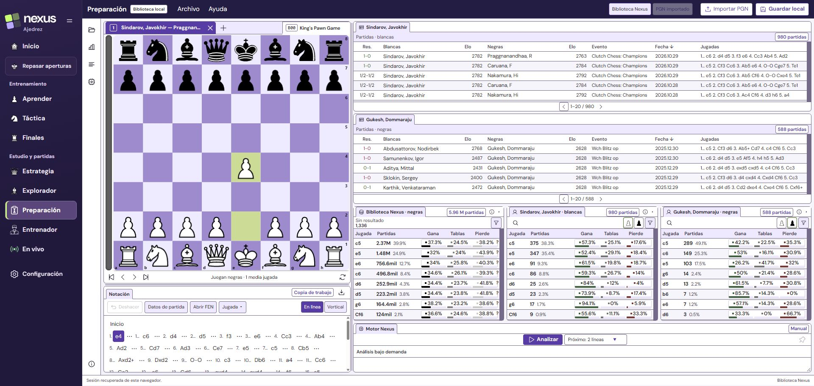
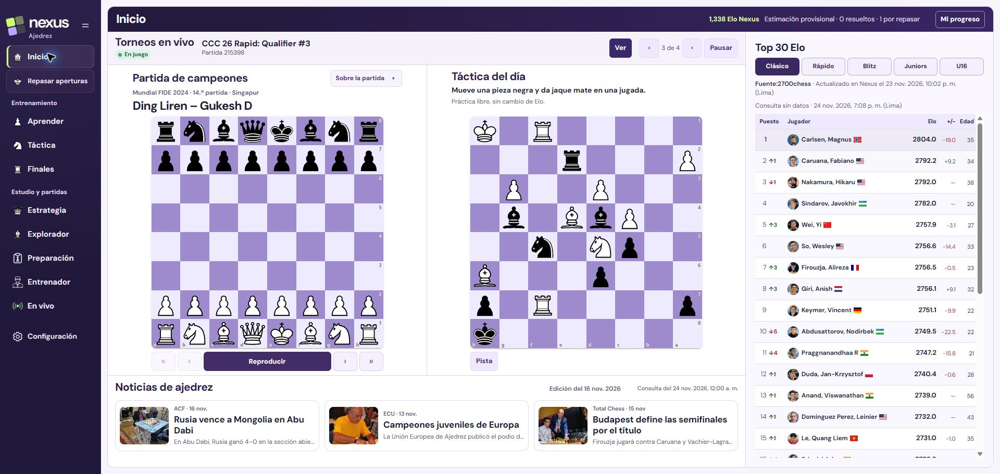
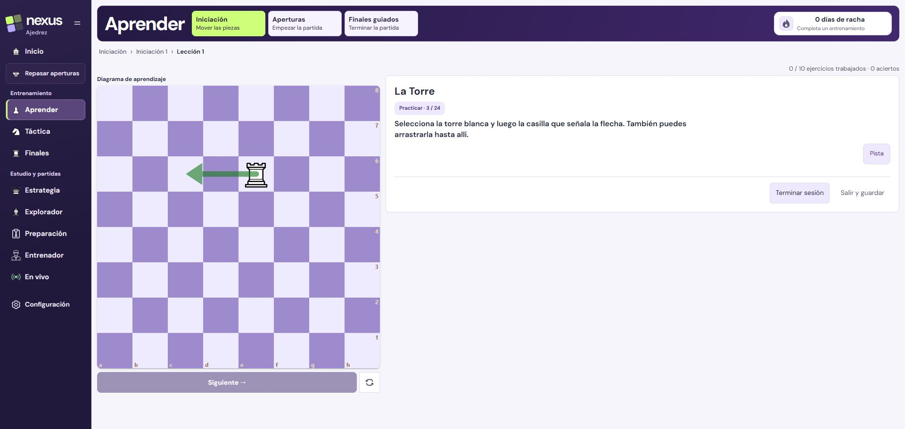
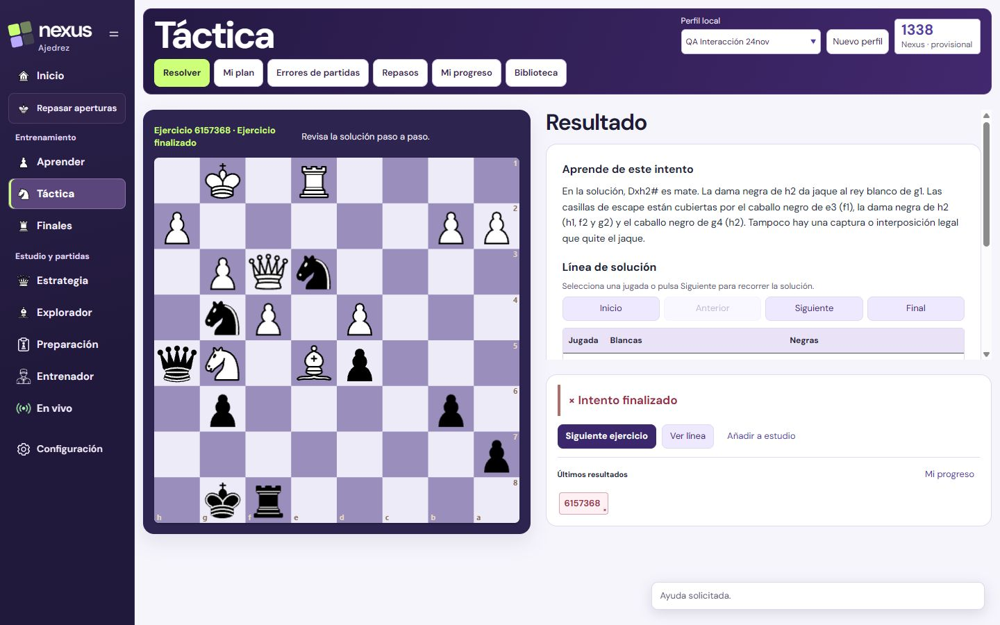
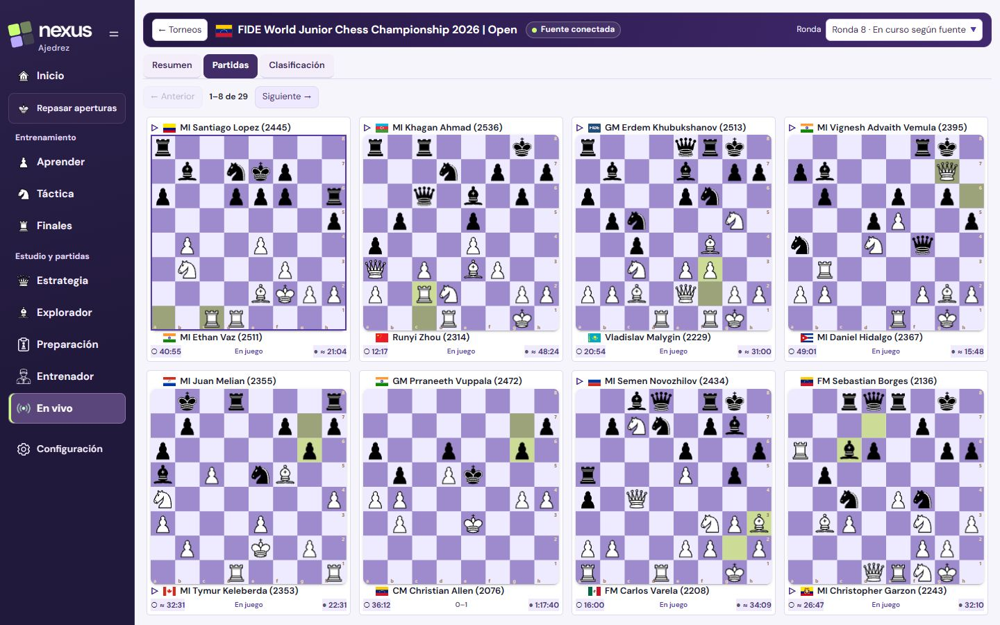

# Ajedrez Nexus

**Estudia ajedrez. Construye tu repertorio. Entrena con propósito.**

Un espacio de trabajo para jugadores y entrenadores: explorar aperturas, comentar partidas, practicar lecciones guiadas, resolver táctica y seguir torneos.

[English](README.md) · [Catálogo funcional](docs/FEATURES.md#español) · [Galería completa](docs/GALLERY.md) · [Estado](docs/PRODUCT_STATUS.md#español) · [Contacto](CONTACT.md)

*Preparación: una posición, dos jugadores y la biblioteca local, con notación y herramientas de análisis. Captura real del 24 de noviembre de 2026.*

## Nuevo: Preparación

Compara dos jugadores sobre la misma posición, consulta las partidas que respaldan sus estadísticas y desarrolla tus propias copias de estudio. Tablero, tres tablas comparativas, listas de partidas, notación y Stockfish comparten un espacio de trabajo.

La actualización del **24 de noviembre de 2026** también muestra lecciones completadas, revisión táctica, objetivos de finales y preferencias visuales compartidas. [Ver las novedades](docs/UPDATES.md#español) · [15 capturas nuevas](docs/GALLERY.md).

## Un recorrido de aprendizaje conectado

| Área | Qué puedes hacer |
| --- | --- |
| **Preparación** | Comparar biblioteca y dos jugadores por color y posición; consultar partidas, editar copias, usar pestañas y analizar con Stockfish. |
| **Explorar y preparar** | Navegar continuaciones de aperturas, comparar estadísticas, filtrar una biblioteca local y crear estudios comentados. |
| **Analizar y explicar** | Revisar variantes de Stockfish, mantener el análisis fijado mientras navegas y exportar estudios a PGN, PDF o HTML. |
| **Aprender y recordar** | Trabajar lecciones de iniciación, repertorios de aperturas y finales guiados, con repasos y progreso guardado. |
| **Entrenar y mejorar** | Resolver ejercicios de táctica, revisar errores y consultar el avance de un perfil local. |
| **Estudiar estrategia** | Explorar posiciones por temas y ensayar tus propias continuaciones en el tablero. |
| **Seguir el ajedrez** | Consultar torneos y una portada con táctica del día, partidas de campeones, noticias y clasificación. |

Nexus conecta estas actividades para convertir la preparación en práctica y orientar la siguiente sesión de estudio.

## Así se ve

<strong>Inicio — estudio y actualidad en una sola vista</strong>

<strong>Aprender — ejercicios guiados sobre el tablero</strong>

<strong>Táctica — comprende la solución</strong>

<strong>En vivo — sigue una ronda tablero a tablero</strong>

El [recorrido visual completo](docs/GALLERY.md) muestra **15 vistas actuales del 24 de noviembre de 2026**. Las 12 capturas anteriores están en un archivo histórico separado. La galería actual incluye Preparación, aprendizaje, táctica, finales, estrategia, torneos y configuración. Los estudios y el PDF de ejemplo anteriores se conservan en el archivo histórico. El [catálogo funcional](docs/FEATURES.md#español) explica cada área.

Las capturas están fechadas; noticias, puntuaciones, estados de torneos y cantidades de partidas son contenido histórico de pantalla. No representan datos actuales ni una base incluida. [Notas de las capturas](docs/screenshots/README.md).

## Disponibilidad

Este es un **repositorio público de presentación del producto**. Contiene documentación y capturas; el código del sistema permanece privado. Aquí no se distribuyen instaladores, bases de partidas, modelos ni paquetes de cursos o audio.

La versión existente se ha probado localmente en **Windows**, con **interfaz en español**. La edición empaquetada para macOS y la interfaz completa en inglés son objetivos de la [hoja de ruta](ROADMAP.md#español), no versiones anunciadas como disponibles. Consulta el [estado del producto](docs/PRODUCT_STATUS.md#español).

## Comentarios y contacto

**Christian Cuba** · [xtiancuba90@gmail.com](mailto:xtiancuba90@gmail.com)

[LinkedIn](https://www.linkedin.com/in/christian-erick-cuba-alejos-096327187/)

Para consultas sobre el producto, uso en clases o colaboración, [contacta aquí](CONTACT.md). Las personas con acceso al repositorio también pueden [reportar problemas o proponer mejoras](https://github.com/KamuiSenpai/ajedrez-nexus/issues/new/choose).

Los nombres y contenidos de terceros visibles en la aplicación corresponden a sus respectivos proveedores. Esta presentación no implica afiliación ni incluye una licencia para redistribuir el software.
