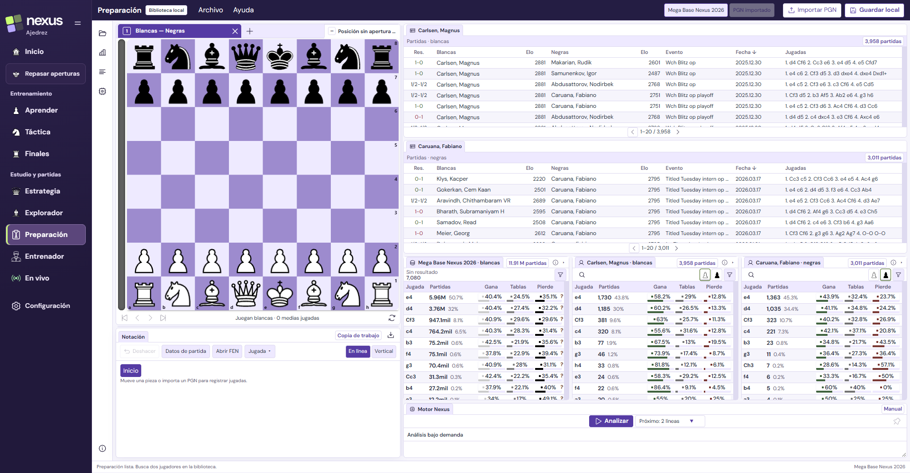
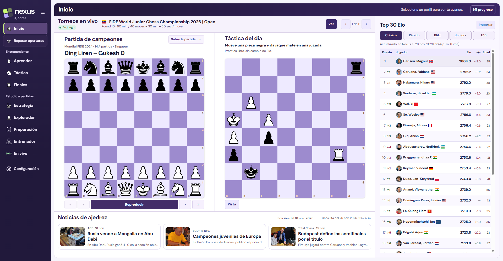
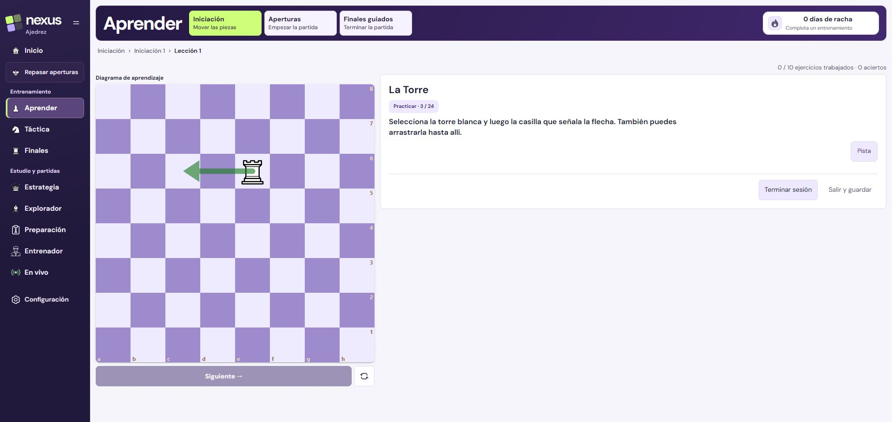
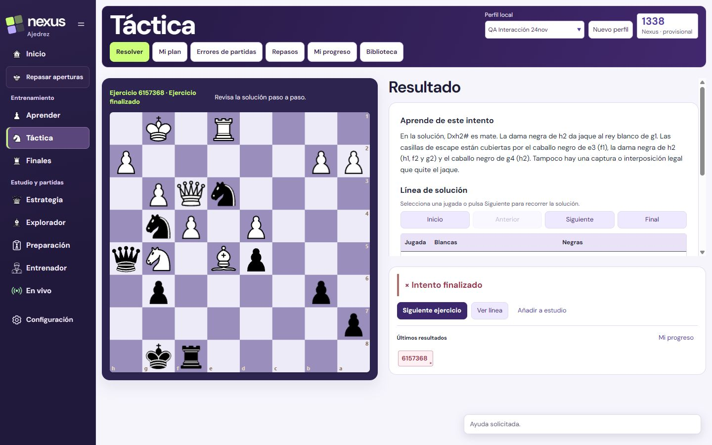
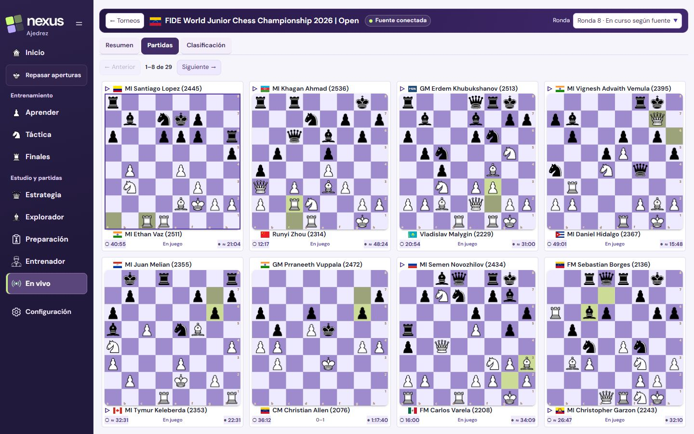

# Ajedrez Nexus

**Study the game. Build your repertoire. Train with purpose.**

A unified chess workspace for players and coaches: explore openings, annotate games, practice guided lessons, solve tactics and follow tournament broadcasts.

[Español](README.es.md) · [Feature catalog](docs/FEATURES.md) · [Full gallery](docs/GALLERY.md) · [Product status](docs/PRODUCT_STATUS.md) · [Contact](CONTACT.md)

*Preparation with Carlsen, Caruana and the local library. Captured on November 26, 2026.*

## New: Preparation

Compare two players against the same position, inspect the games behind their statistics and develop your own working studies. A connected layout brings the board, three comparison tables, game lists, notation and Stockfish together.

The **November 26, 2026** update adds an adjustable Explorer board and shows how to pick different players in Preparation. [Explore what is new](docs/UPDATES.md#english) · [18 screenshots](docs/GALLERY.md).

## One workspace, a connected learning journey

| Area | What you can do |
| --- | --- |
| **Preparation** | Compare the library and two players by color and position; inspect games, edit working copies, use tabs and analyze with Stockfish. |
| **Explore & prepare** | Navigate opening continuations, compare game statistics, filter a local game library and build annotated studies. |
| **Analyze & explain** | Review Stockfish variations, keep analysis pinned to a position while navigating, and export studies as PGN, PDF or HTML. |
| **Learn & remember** | Work through introductory lessons, opening repertoires and guided endgames, with review sessions and saved progress. |
| **Train & improve** | Solve tactical exercises, revisit mistakes and track a local training profile. |
| **Study strategic ideas** | Explore themed positions and try your own continuations on the board. |
| **Follow the chess world** | Browse tournament broadcasts and a home dashboard with a daily tactic, champion-game playback, news and rankings. |

Nexus brings these activities together so preparation can become practice, and practice can inform the next study session.

## A look inside

<strong>Home — a starting point for study and discovery</strong>

<strong>Learn — guided exercises on the board</strong>

<strong>Train — understand the solution</strong>

<strong>Follow — a round board by board</strong>

The gallery includes the adjustable Explorer, Preparation comparisons, training, tournaments and board preferences. It contains **18 views from November 24 and 26, 2026**. [Visual tour](docs/GALLERY.md) · [Feature catalog](docs/FEATURES.md).

Screenshots carry their capture dates. News, ratings, tournament states and library counts are historical screen content, not current data or an included dataset. [Screenshot notes](docs/screenshots/README.md).

## Availability

This is a **public product presentation repository**. It contains documentation and screenshots; application source code remains private. Installers, game databases, models and course or audio packages are not distributed here.

The existing build has been exercised locally on **Windows**, with a **Spanish interface**. A packaged macOS edition and a full English interface are [roadmap objectives](ROADMAP.md), not currently announced releases. See [product status](docs/PRODUCT_STATUS.md) for the boundaries of this preview.

## Feedback & contact

**Christian Cuba** · [xtiancuba90@gmail.com](mailto:xtiancuba90@gmail.com)

[LinkedIn](https://www.linkedin.com/in/christian-erick-cuba-alejos-096327187/)

For product questions, coaching use cases or collaboration, [get in touch](CONTACT.md). Repository members can also [report a problem or suggest an improvement](https://github.com/KamuiSenpai/ajedrez-nexus/issues/new/choose).

Third-party names and content visible inside the application remain associated with their respective providers. This presentation does not imply affiliation or include a software redistribution license.
