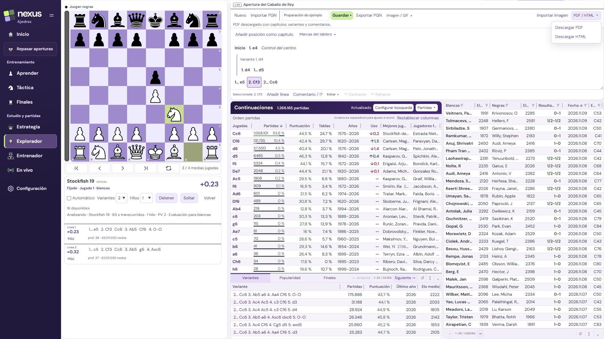
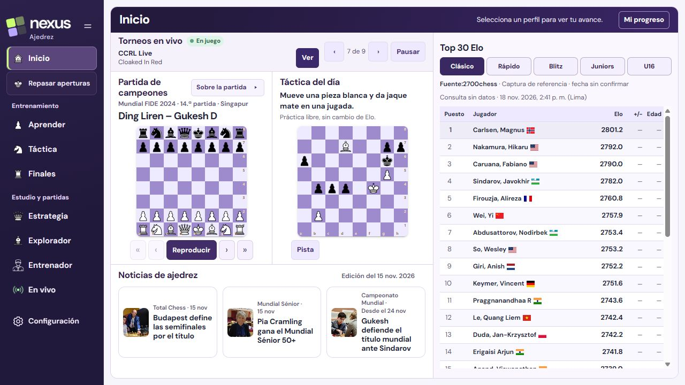
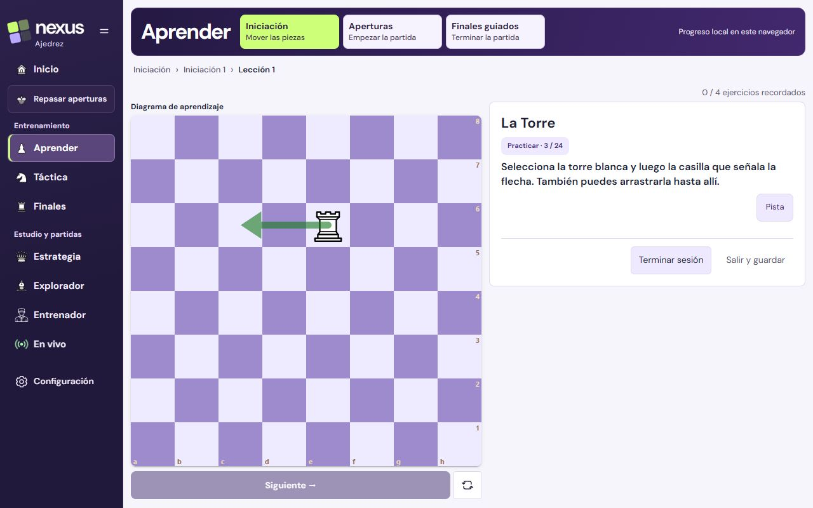
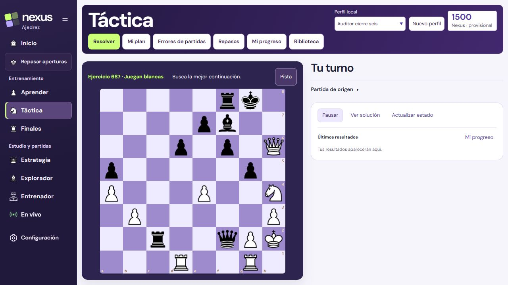
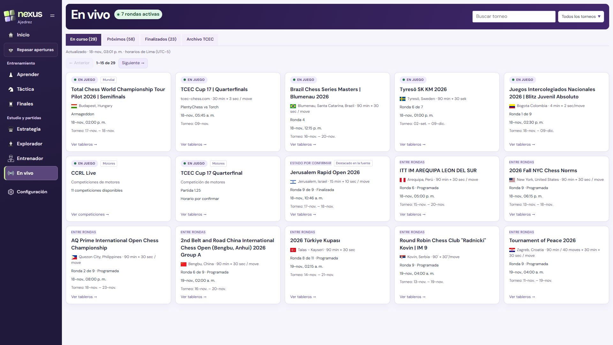

# Ajedrez Nexus

**Study the game. Build your repertoire. Train with purpose.**

A unified chess workspace for players and coaches: explore openings, annotate games, practice guided lessons, solve tactics and follow tournament broadcasts.

[Español](README.es.md) · [Feature catalog](docs/FEATURES.md) · [Full gallery](docs/GALLERY.md) · [Product status](docs/PRODUCT_STATUS.md) · [Contact](CONTACT.md)

*Opening exploration, an annotated example study, pinned engine analysis and document export in the local build.*

## One workspace, a connected learning journey

| Area | What you can do |
| --- | --- |
| **Explore & prepare** | Navigate opening continuations, compare game statistics, filter a local game library and build annotated studies. |
| **Analyze & explain** | Review Stockfish variations, keep analysis pinned to a position while navigating, and export studies as PGN, PDF or HTML. |
| **Learn & remember** | Work through introductory lessons, opening repertoires and guided endgames, with review sessions and saved progress. |
| **Train & improve** | Solve tactical exercises, revisit mistakes and track a local training profile. |
| **Study strategic ideas** | Explore themed positions and try your own continuations on the board. |
| **Follow the chess world** | Browse tournament broadcasts and a home dashboard with a daily tactic, champion-game playback, news and rankings. |

Nexus brings these activities together so preparation can become practice, and practice can inform the next study session.

## A look inside

<strong>Home — a starting point for study and discovery</strong>

<strong>Learn — guided exercises on the board</strong>

<strong>Train — focused tactical practice</strong>

<strong>Follow — tournament discovery</strong>

The [complete visual tour](docs/GALLERY.md) covers **12 views**, including opening repertoires, endgames, strategy, the coach workspace, settings, lesson completion and a PDF example. The [feature catalog](docs/FEATURES.md) explains the workflows beyond this cover selection.

Screenshots and the sample document represent local builds captured on **November 17–18, 2026**. News, ratings, tournament states and library counts are historical screen content, not current data or an included dataset. [Screenshot notes](docs/screenshots/README.md).

## Availability

This is a **public product presentation repository**. It contains documentation and screenshots; application source code remains private. Installers, game databases, models and course or audio packages are not distributed here.

The existing build has been exercised locally on **Windows**, with a **Spanish interface**. A packaged macOS edition and a full English interface are [roadmap objectives](ROADMAP.md), not currently announced releases. See [product status](docs/PRODUCT_STATUS.md) for the boundaries of this preview.

## Feedback & contact

**Christian Cuba** · [xtiancuba90@gmail.com](mailto:xtiancuba90@gmail.com)

[LinkedIn](https://www.linkedin.com/in/christian-erick-cuba-alejos-096327187/)

For product questions, coaching use cases or collaboration, [get in touch](CONTACT.md). Repository members can also [report a problem or suggest an improvement](https://github.com/KamuiSenpai/ajedrez-nexus/issues/new/choose).

Third-party names and content visible inside the application remain associated with their respective providers. This presentation does not imply affiliation or include a software redistribution license.
