# Inside Ajedrez Nexus / Recorrido visual

[English overview](../README.md) · [Presentación en español](../README.es.md) · [Functions / Funciones](FEATURES.md) · [What is new / Novedades](UPDATES.md)

**15 current product views, captured November 24, 2026.** Full application views are preserved. Player profiles labeled QA and learning progress are demonstration content. Dynamic values are historical, not a live feed or an included dataset.

**15 vistas actuales, capturadas el 24 de noviembre de 2026.** Se conservan las vistas completas. Los perfiles QA y el progreso son de demostración. Los datos dinámicos son históricos, no una transmisión ni una base incluida.

## November 24, 2026 / 24 de noviembre de 2026

### 1. Preparation at a glance / Preparación de un vistazo

One position, two players and the library, with board, notation, supporting games and engine controls.

Una posición, dos jugadores y la biblioteca, con tablero, notación, partidas de respaldo y controles de motor.

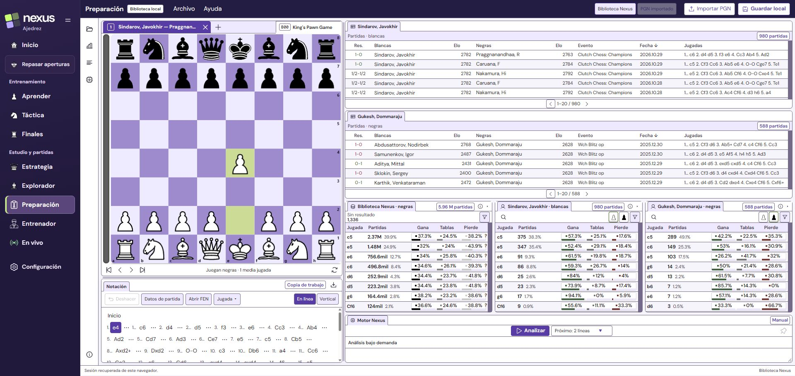

### 2. Compare responses / Compara respuestas

Sindarov and Gukesh by color, with supporting games and separate counts, frequency and win/draw/loss columns.

Sindarov y Gukesh por bando, con partidas de respaldo y columnas separadas para cantidad, frecuencia y victorias/tablas/derrotas.

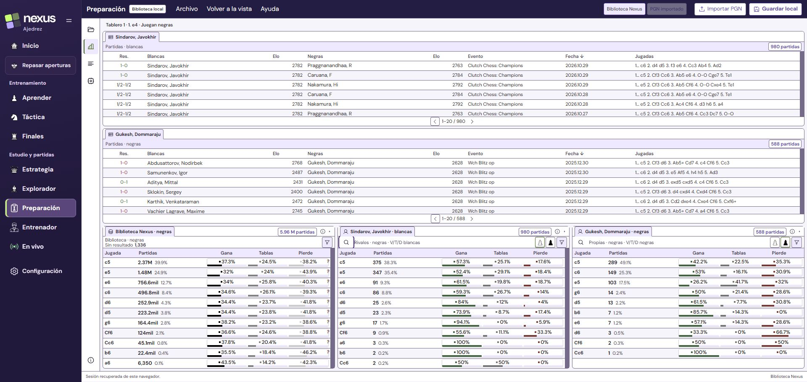

<strong>3. A connected starting point / Un punto de partida conectado</strong>

### 3. A connected starting point / Un punto de partida conectado

Champion-game playback, the daily tactic, tournament discovery, news and ratings. Source dates and unavailable states remain visible.

Partidas de campeones, táctica del día, torneos, noticias y clasificación. Las fechas y los estados sin datos permanecen visibles.

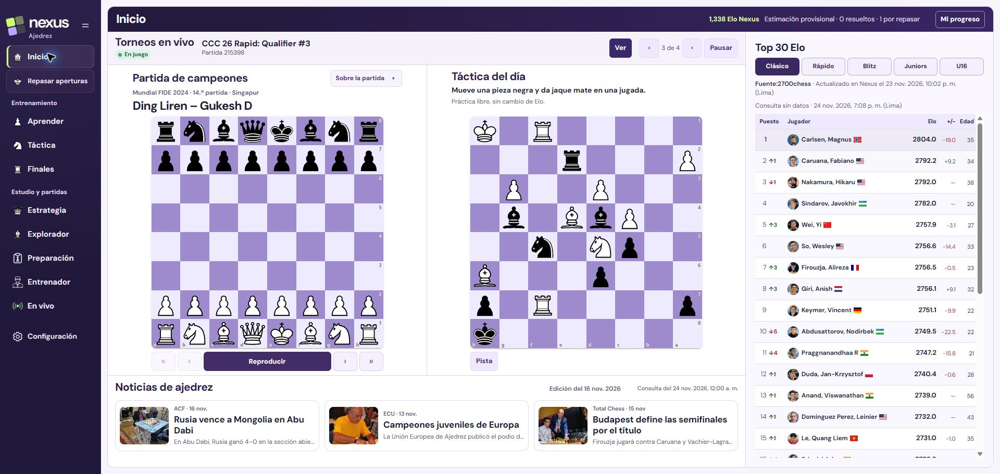

<strong>4. Learn by playing / Aprende jugando</strong>

### 4. Learn by playing / Aprende jugando

An introductory rook exercise combines a visual prompt and interaction on the board.

Un ejercicio de iniciación sobre la torre combina una consigna visual e interacción en el tablero.

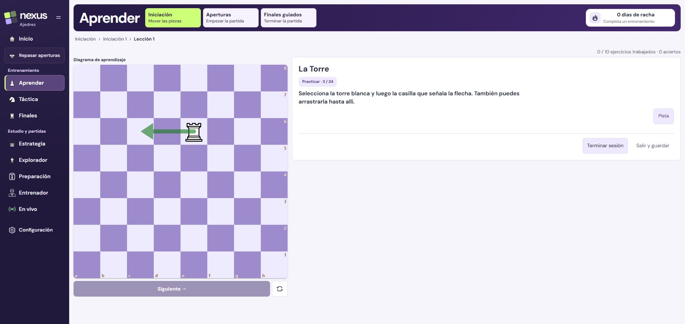

<strong>5. A clear next step / Un siguiente paso claro</strong>

### 5. A clear next step / Un siguiente paso claro

A completed demonstration lesson records 10/10 exercises and offers the next lesson without forcing navigation.

Una lección de demostración completada registra 10/10 ejercicios y ofrece la siguiente lección sin forzar la navegación.

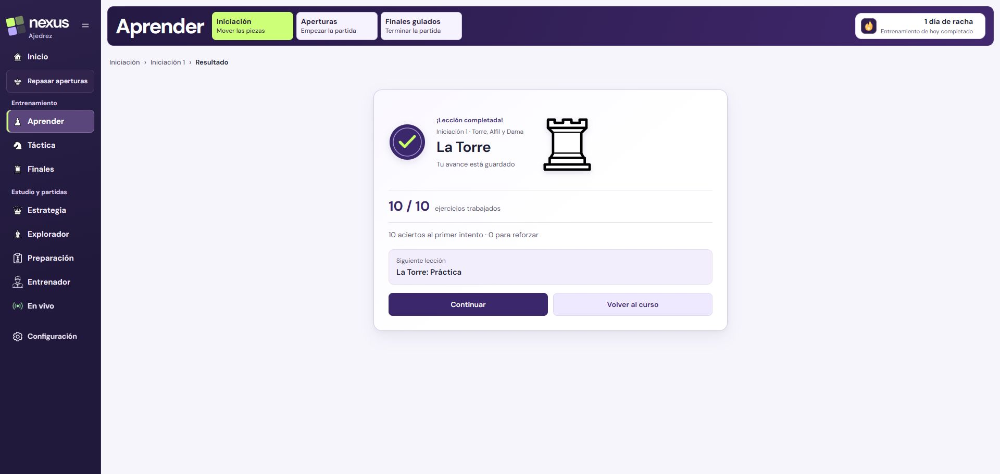

<strong>6. Review a tactical solution / Revisa una solución táctica</strong>

### 6. Review a tactical solution / Revisa una solución táctica

A demonstration result connects the board, explanation and move-by-move solution controls. Nexus training ratings are not FIDE ratings.

Un resultado de demostración conecta tablero, explicación y controles de la solución por jugadas. La puntuación Nexus no es el Elo FIDE.

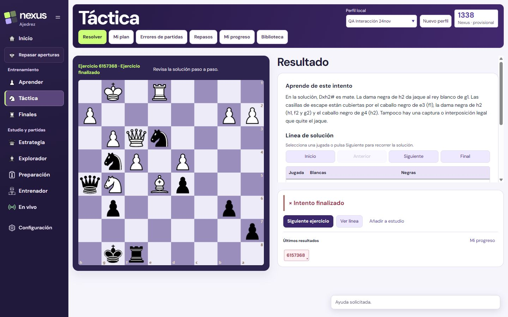

<strong>7. Find an exercise / Encuentra un ejercicio</strong>

### 7. Find an exercise / Encuentra un ejercicio

Filter by theme, opening family or difficulty. The QA profile and local collection counts are demonstration screen content.

Filtra por motivo, familia de apertura o dificultad. El perfil QA y las cantidades de la colección son contenido de demostración de pantalla.

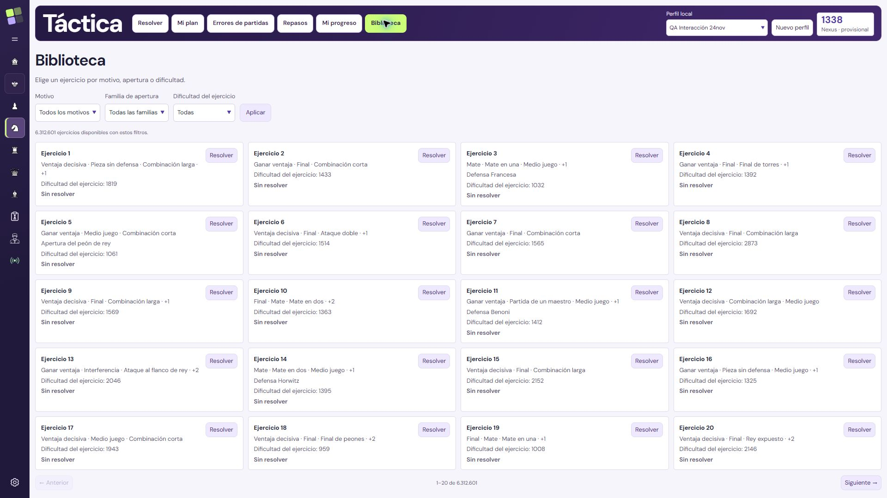

<strong>8. An endgame objective achieved / Un objetivo de finales conseguido</strong>

### 8. An endgame objective achieved / Un objetivo de finales conseguido

A legal mating move completes the objective and updates the demonstration profile. Method and next-position controls stay available.

Una jugada legal de mate completa el objetivo y actualiza el perfil de demostración. Se conservan método y controles de la siguiente posición.

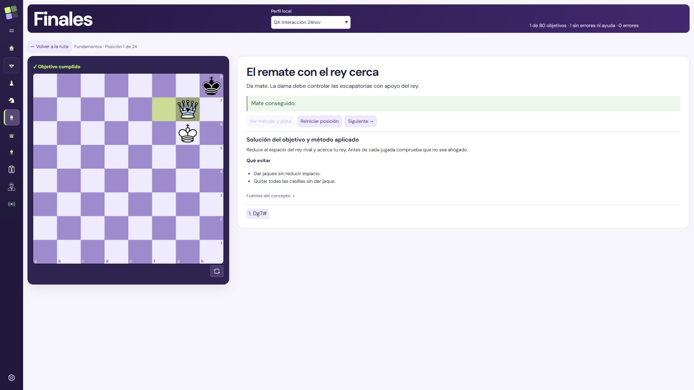

<strong>9. Study a strategic idea / Estudia una idea estratégica</strong>

### 9. Study a strategic idea / Estudia una idea estratégica

Themed positions, your own continuation and study-session tools alongside the board.

Posiciones temáticas, una continuación propia y herramientas de sesión junto al tablero.

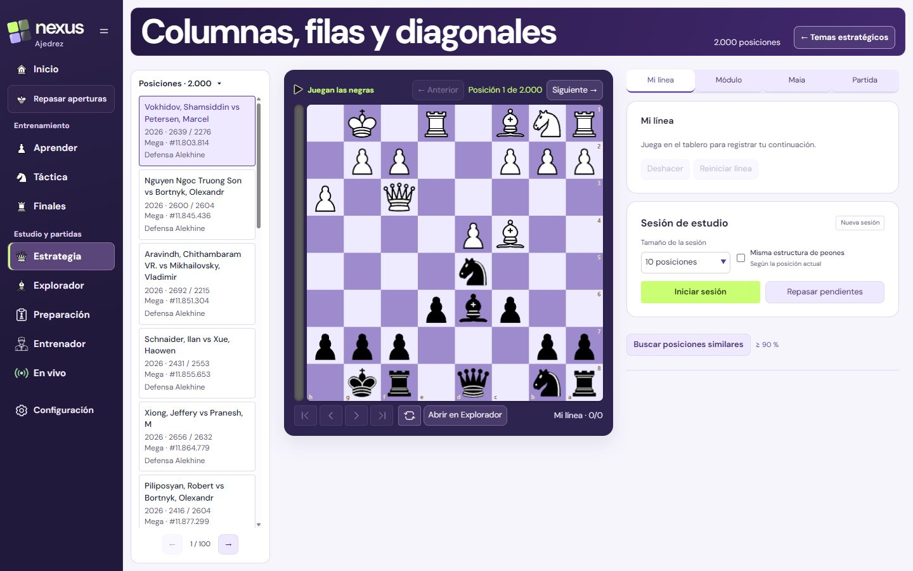

<strong>10. Follow a round / Sigue una ronda</strong>

### 10. Follow a round / Sigue una ronda

Eight visible boards from a 29-game round, with player names, titles, flags and clocks. Historical broadcast content.

Ocho tableros visibles de una ronda de 29 partidas, con nombres, títulos, banderas y relojes. Contenido histórico de la transmisión.

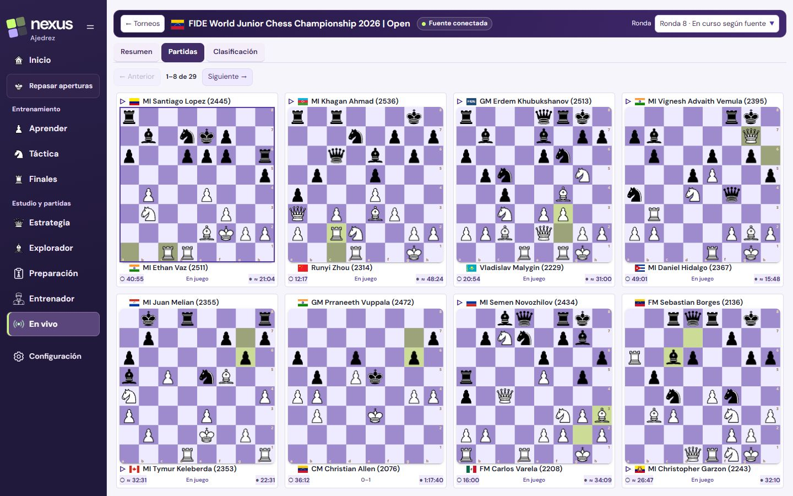

<strong>11. Review and return to live / Revisa y vuelve al directo</strong>

### 11. Review and return to live / Revisa y vuelve al directo

The viewer shows move history and an explicit return-to-live action. This capture is in Review mode, with the engine ready to analyze.

El visor muestra el historial y una acción explícita para volver al directo. La captura está en modo Revisión y el motor está listo para analizar.

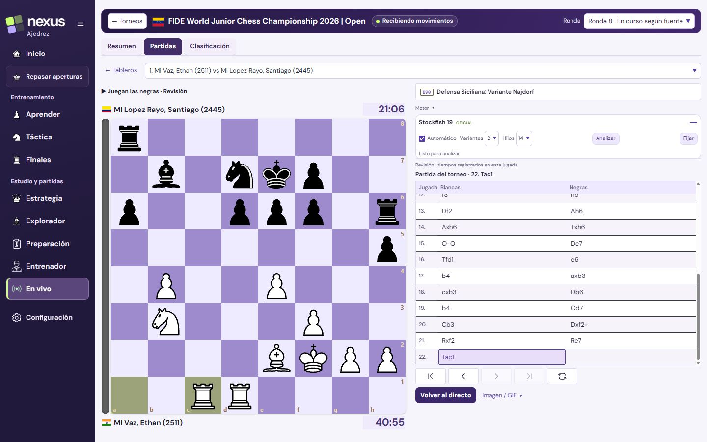

<strong>12. Standings with publication context / Clasificación con contexto</strong>

### 12. Standings with publication context / Clasificación con contexto

A preliminary list with a published round 0 cut is distinguished from the selected round 8. The source values are preserved.

Una lista preliminar con corte publicado de ronda 0 se distingue de la ronda 8 seleccionada. Se conservan los valores de la fuente.

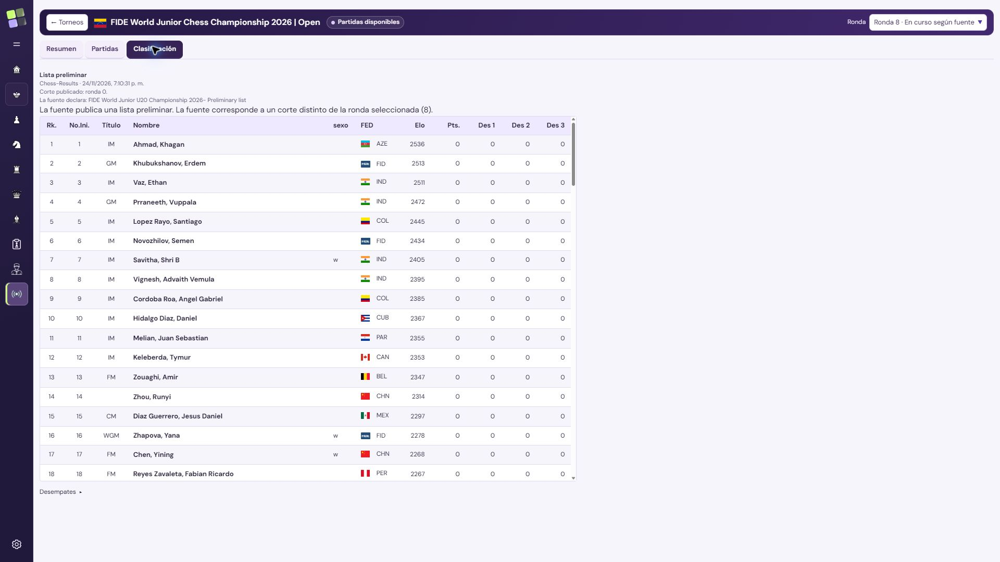

<strong>13. Make the board your own / Personaliza el tablero</strong>

### 13. Make the board your own / Personaliza el tablero

Shared board palettes, piece styles, text size, contrast and training-sound preferences.

Paletas, modelos de piezas, texto, contraste y preferencias de sonidos de entrenamiento compartidos.

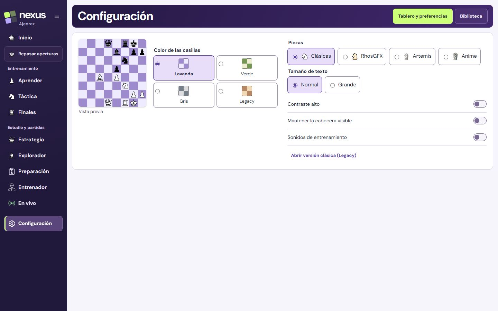

<strong>14. Readable in a narrow window / Legible en una ventana estrecha</strong>

### 14. Readable in a narrow window / Legible en una ventana estrecha

Settings at 390px with large text, high contrast, Legacy colors and Artemis pieces. Responsive browser layout, not a native mobile application.

Configuración a 390px con texto grande, contraste alto, colores Legacy y piezas Artemis. Es una vista web adaptable, no una aplicación móvil nativa.

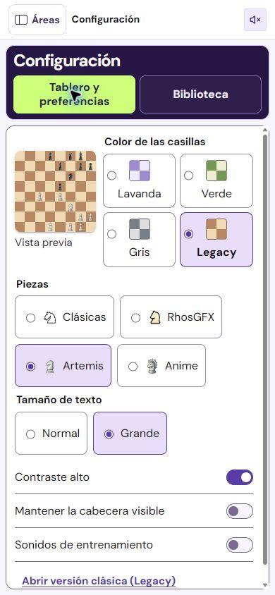

<strong>15. Know the library update status / Conoce el estado de la biblioteca</strong>

### 15. Know the library update status / Conoce el estado de la biblioteca

TWIC integrated edition, newest known edition and check time are separate. The pictured newer edition is awaiting certification.

Se distinguen edición TWIC integrada, última conocida y fecha de consulta. La edición nueva de la captura espera certificación.

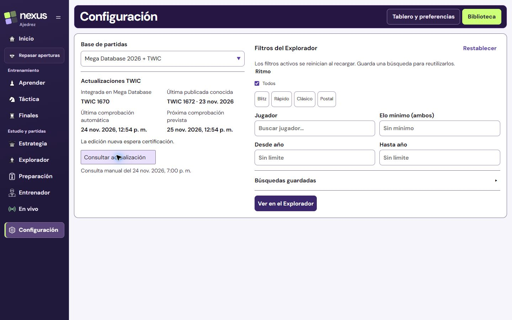

## Image notes / Notas de las imágenes

[Dates and provenance / Fechas y procedencia](screenshots/README.md) · [Earlier reference archive / Archivo histórico separado](archive/GALLERY-2026-11-18.md).
