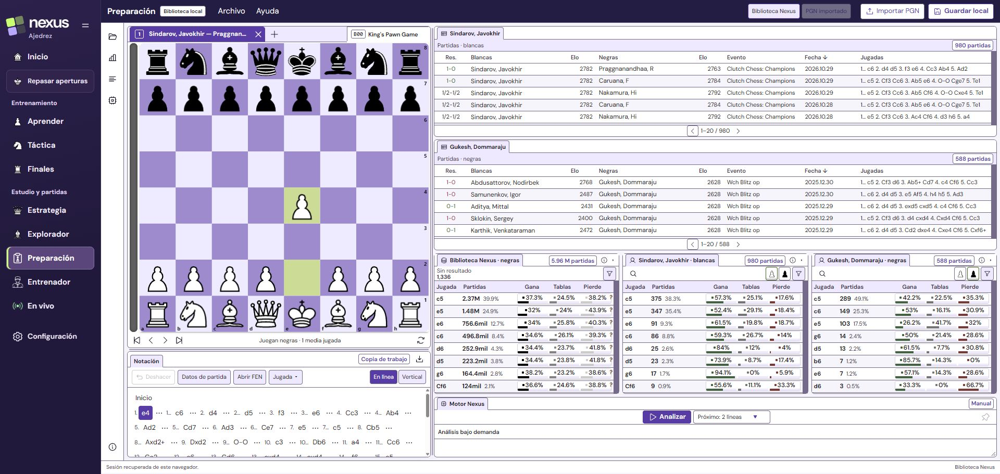

# New in Nexus / Novedades de Nexus

[English](#english) · [Español](#español) · [Gallery / Galería](GALLERY.md) · [Status / Estado](PRODUCT_STATUS.md)

## English

**Product preview · November 24, 2026**

Prepare against a player, explore an opening idea and turn the position into something you can study. The new **Preparation** workspace brings the board, games, player statistics, notation and engine analysis into one connected view.

This update documents the current local Windows build. The interface shown is Spanish; a full English interface and packaged macOS edition remain roadmap objectives. This repository presents the product through documentation and selected screenshots. It does not distribute the application, source code, databases or course packages.

### Preparation: see the position from three perspectives

#### Compare players on the same board

Choose two players from the local library and select a color for each. Follow how the same position appears in the library and in each player's games. The illustrated comparison uses published games by **Javokhir Sindarov** and **Gukesh Dommaraju**; names and collections follow the records available in the library.

The layout keeps a board and notation together on the left, two game lists above the comparison tables, and engine analysis below. Each panel identifies its player, color or collection so the source of a result stays visible while you explore.

#### Read the statistics without losing their meaning

Three tables show the library, player one and player two. They separate the move, game count, frequency and **wins / draws / losses**. Every result percentage has its own labeled column and indicator. Missing results and collection coverage remain explicit rather than being treated as draws or silently included in a percentage.

Use the supporting game lists to inspect the games behind a position, change the order and move through the pages. Supported filters narrow the selected collection; unavailable metadata is not guessed. Totals describe the selected library scope, rather than the few rows currently visible on screen.

#### Develop your own preparation

Open a game as a working copy, navigate its moves, add a variation or comment, and keep several boards open in tabs. Switch between inline and vertical notation, or open an independent position to investigate another idea. Original library records remain separate from the working copy.

Save preparation in the current browser and return to unfinished work. Closing or saving one document preserves the other open documents. These are local browser saves, not cloud synchronization or an included online account.

#### Analyze a position while exploring another

Request Stockfish analysis, inspect its suggested lines and use the evaluation bar alongside the board. Pin an analysis position when you want to keep that reference while navigating elsewhere; return to the anchor or release it to follow the board again. The interface distinguishes the visible board from a pinned engine position.

### More continuity across Nexus

| Area | What the current build brings together |
| --- | --- |
| **Learn** | Guided board exercises, saved progress, completed-lesson summaries, streak feedback and a clear choice of the next lesson. Completion records the work; it does not force the learner into the next lesson. |
| **Tactics** | Solving, plans, game mistakes, reviews, progress and a filterable exercise library under one local training profile. Pausing and reviewing a solution have explicit states; Spanish theme names and notation are consistent. Nexus training ratings are not official FIDE ratings. |
| **Endgames** | Learning routes with concrete objectives, legal board moves, method/hint guidance and saved progress. A completed objective is recognized on the board; help remains available when returning to the position. |
| **Strategy** | Themed positions, a personal continuation, source-game details, Stockfish and human-move suggestions where available. Study sessions and similar-position searches support exploring an idea in more than one position. |
| **Explorer** | Opening recognition, continuations and supporting games, annotated PGN with variations, filtered searches and engine-position pinning. |
| **Live tournaments** | Tournament discovery, board mosaics, player information, game history and an explicit return to the live position. Standings show the publication context supplied by the source, including a preliminary list or an earlier round. |
| **Settings** | Board palettes, piece styles, normal or large text, contrast, training sounds and library preferences. The library view distinguishes the integrated TWIC edition from a newly known edition and shows the time of the update check. |
| **Narrow windows** | Preparation uses compact panels and mobile navigation; settings and board controls reflow for narrow browser windows. Large text remains a shared preference. |

### Preview status

The current review covered the main Nexus areas and included desktop and narrow-window interaction. It recorded **37 cases approved within their tested scope and 16 partially validated cases**. This is a bounded review, not a claim that every feature, position or failure condition has been certified.

New AI coach explanations require a configured provider. Broadcasts, news, ratings and player profiles depend on external sources; the application shows publication dates, cached content or unavailable states where applicable. Screenshots document the captured build and may contain historical data. A static screenshot does not demonstrate an animation, audible sound, uninterrupted live connection or successful download.

The gallery contains 15 dated captures from November 24, 2026 with 12 earlier references kept in a separate historical archive. QA profiles and example progress are demonstration content; no personal preparation or dataset is distributed here.

---

## Español

**Vista previa del producto · 24 de noviembre de 2026**

Prepara una partida contra un jugador, explora una idea de apertura y convierte esa posición en material de estudio. El nuevo espacio **Preparación** reúne tablero, partidas, estadísticas de jugadores, notación y análisis de motor en una misma vista.

Esta actualización documenta la versión local actual para Windows. La interfaz mostrada está en español; una traducción completa al inglés y una edición empaquetada para macOS siguen siendo objetivos de la hoja de ruta. El repositorio presenta el producto mediante documentación y capturas seleccionadas. No distribuye la aplicación, su código, bases de datos ni paquetes de cursos.

### Preparación: una posición, tres perspectivas

#### Compara jugadores sobre el mismo tablero

Elige dos jugadores de la biblioteca local y selecciona el color de cada uno. Observa cómo aparece la misma posición en la biblioteca y en las partidas de cada protagonista. La comparación ilustrada utiliza partidas publicadas de **Javokhir Sindarov** y **Gukesh Dommaraju**; los nombres y las colecciones corresponden a los registros disponibles en la biblioteca.

El tablero y la notación comparten la zona izquierda; las dos listas de partidas aparecen sobre las tablas comparativas y el motor se sitúa debajo. Cada panel identifica su jugador, color o colección para que puedas reconocer el origen de los resultados mientras exploras.

#### Lee las estadísticas sin perder su significado

Tres tablas muestran la biblioteca, el primer jugador y el segundo jugador. Separan jugada, cantidad de partidas, frecuencia y **victorias / tablas / derrotas**. Cada porcentaje conserva su propia columna e indicador. Los resultados ausentes y la cobertura de la colección permanecen explícitos: no se convierten en tablas ni se incluyen silenciosamente en un porcentaje.

Consulta las listas de respaldo para ver las partidas relacionadas con la posición, cambiar su orden y recorrer las páginas. Los filtros admitidos acotan la colección elegida; no se suponen metadatos que faltan. Los totales describen el ámbito seleccionado de la biblioteca, no únicamente las filas visibles en pantalla.

#### Construye tu propia preparación

Abre una partida como copia de trabajo, recorre sus jugadas, añade una variante o un comentario y mantén varios tableros abiertos en pestañas. Alterna la notación en línea y vertical o abre una posición independiente para investigar otra idea. El registro original de la biblioteca permanece separado de la copia de trabajo.

Guarda la preparación en el navegador actual y retoma el trabajo pendiente. Cerrar o guardar un documento conserva los demás documentos abiertos. Son guardados locales del navegador; no representan sincronización en la nube ni una cuenta en línea incluida.

#### Analiza una posición mientras exploras otra

Solicita un análisis de Stockfish, consulta sus variantes y utiliza la barra de evaluación junto al tablero. Fija una posición de análisis cuando quieras mantener esa referencia mientras navegas por otro punto; vuelve al ancla o libérala para seguir el tablero. La interfaz distingue la posición visible de la posición fijada al motor.

### Más continuidad entre las áreas de Nexus

| Área | Qué reúne la versión actual |
| --- | --- |
| **Aprender** | Ejercicios guiados en el tablero, avance guardado, resumen de lección, racha y una elección clara de la siguiente lección. La finalización registra el trabajo, sin obligar al alumno a pasar a la próxima lección. |
| **Táctica** | Resolver, planes, errores de partidas, repasos, progreso y biblioteca filtrable bajo un perfil local de entrenamiento. La pausa y la revisión de la solución tienen estados explícitos; los motivos y la notación mantienen el español. La puntuación Nexus no es el Elo oficial FIDE. |
| **Finales** | Rutas con objetivos concretos, movimientos legales, método y pistas, y progreso guardado. El objetivo completado se reconoce en el tablero; la ayuda sigue disponible al retomar la posición. |
| **Estrategia** | Posiciones por temas, una continuación propia, datos de la partida de origen, Stockfish y sugerencias de jugada humana cuando están disponibles. Las sesiones y la búsqueda de posiciones similares permiten estudiar una idea en distintos ejemplos. |
| **Explorador** | Reconocimiento de aperturas, continuaciones y partidas de respaldo, PGN comentado con variantes, búsquedas filtradas y fijación de la posición del motor. |
| **En vivo** | Catálogo de torneos, mosaico de tableros, información de jugadores, historial de la partida y regreso explícito al directo. La clasificación muestra el contexto publicado por su fuente, incluida una lista preliminar o una ronda anterior. |
| **Configuración** | Paletas, modelos de piezas, texto normal o grande, contraste, sonidos de entrenamiento y preferencias de biblioteca. La vista de biblioteca distingue la edición TWIC integrada de una edición nueva conocida y muestra cuándo se realizó la consulta de actualización. |
| **Ventanas estrechas** | Preparación utiliza paneles compactos y navegación móvil; Configuración y los controles del tablero se reorganizan en anchos reducidos. El tamaño de texto grande es una preferencia compartida. |

### Estado de esta vista previa

La revisión actual recorrió las áreas principales de Nexus e incluyó interacciones en escritorio y ventanas estrechas. Registró **37 casos aprobados dentro del alcance probado y 16 casos parcialmente validados**. Es una revisión acotada, no una certificación de todas las funciones, posiciones o condiciones de fallo.

Las explicaciones nuevas del entrenador con IA requieren un proveedor configurado. Transmisiones, noticias, clasificaciones y fichas de jugadores dependen de fuentes externas; la aplicación muestra las fechas, el contenido conservado o la ausencia de datos cuando corresponde. Las capturas documentan la versión observada y pueden contener datos históricos. Una imagen estática no demuestra una animación, un sonido audible, una conexión en vivo ininterrumpida ni una descarga completada.

La galería incluye 15 capturas fechadas del 24 de noviembre de 2026 y conserva las 12 referencias anteriores en un archivo histórico separado. Los perfiles QA y el progreso mostrado son de demostración; aquí no se distribuye una preparación personal ni una base de partidas.
