# Historical reference — November 17–18, 2026 / Archivo histórico

These images show an earlier build and are not the current interface. / Estas imágenes pertenecen a una versión anterior; no representan la interfaz actual.

[Current gallery / Galería actual](../GALLERY.md)

## Earlier product tour / Recorrido anterior

[English overview](../../README.md) · [Presentación en español](../../README.es.md) · [Feature catalog / Funciones](../FEATURES.md)

**12 real views of local builds, captured November 17–18, 2026.** These illustrate the product and historical data; they are not live dashboards. The PDF image is a rendered test document. [Provenance and dates / Procedencia y fechas](../screenshots/README.md).

**12 vistas reales de versiones locales, del 17–18 de noviembre de 2026.** Ilustran el producto y datos históricos; no son pantallas en directo. La imagen PDF corresponde a un documento de prueba renderizado.

## 1. Home / Inicio

Champion-game playback, daily tactics, tournament discovery, news and rankings in one starting view. / Partida de campeones, táctica del día, torneos, noticias y clasificación en una portada.

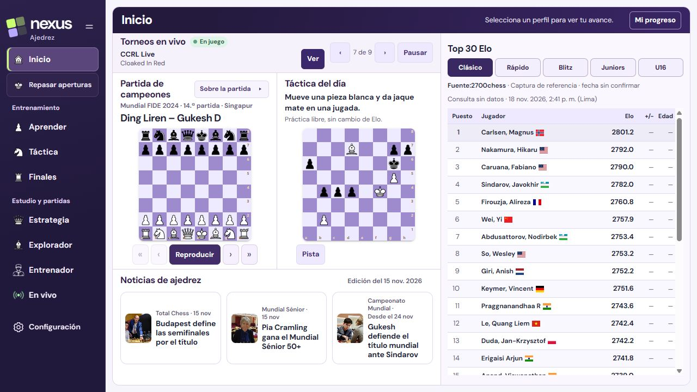

## 2. Explorer, studies & analysis / Explorador, estudios y análisis

An annotated example study alongside opening statistics, game results, pinned Stockfish analysis and document export. / Estudio comentado de ejemplo junto a estadísticas, partidas, análisis Stockfish fijado y exportación.

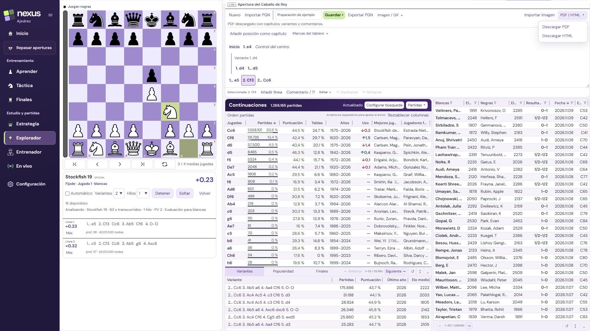

## 3. Guided learning / Iniciación guiada

A rook movement lesson with a visual prompt and on-board interaction. / Lección de movimiento de la torre con consigna visual e interacción en el tablero.

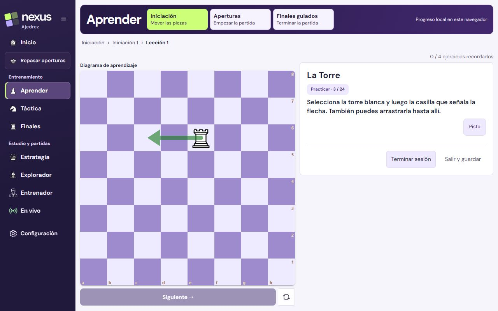

## 4. Tactical practice / Práctica táctica

A tactical exercise with hints, source-game context and review controls. The profile is an audit demonstration. / Ejercicio con pistas, contexto de la partida y revisión; el perfil es de demostración de auditoría.

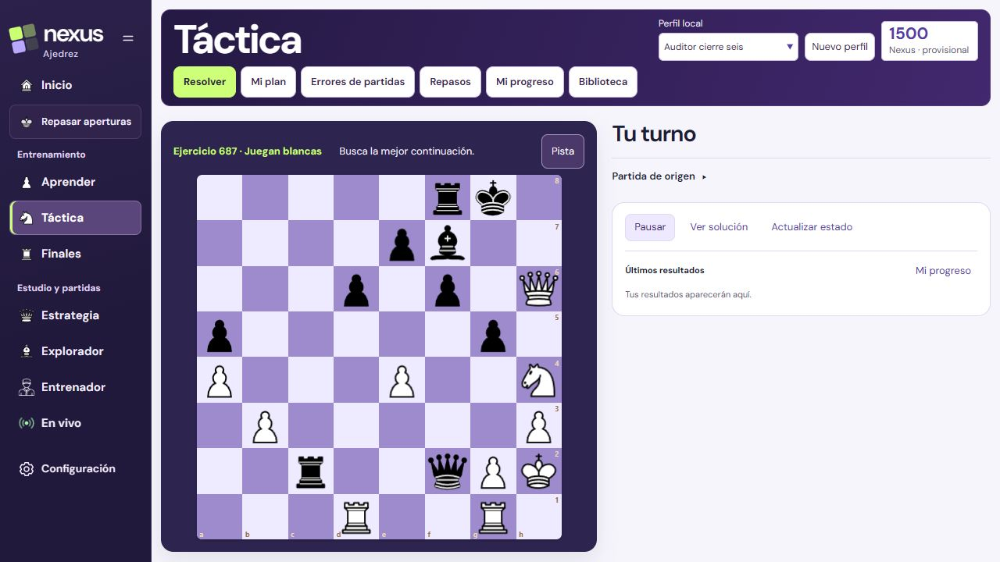

## 5. Tournament discovery / Catálogo de torneos

Events grouped by status, with rounds, venues and broadcast access. The visible event states are historical. / Eventos por estado, rondas, sedes y acceso a transmisiones. Los estados visibles son históricos.

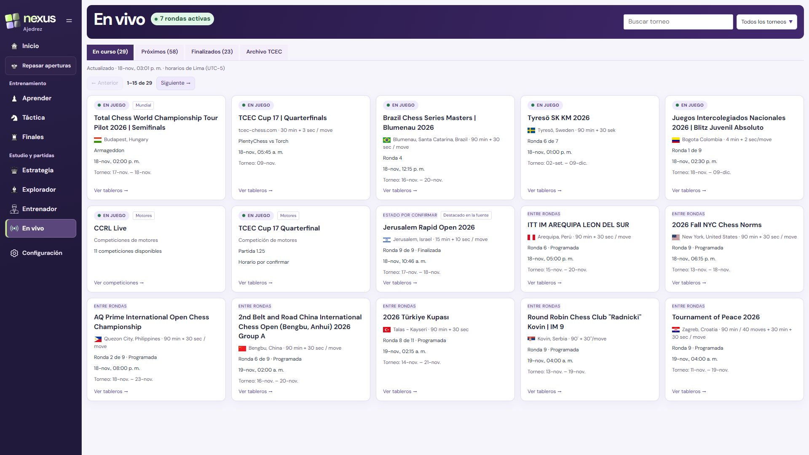

## 6. Opening repertoire / Repertorio de aperturas

Step-by-step opening practice with a learning goal, lesson positions and study-rank feedback. / Práctica paso a paso con meta de aprendizaje, posiciones de la lección y rango de estudio.

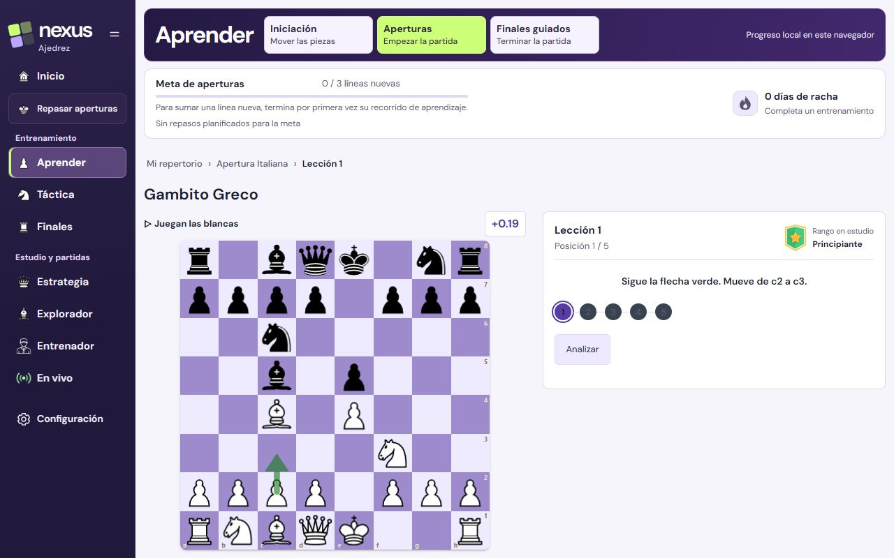

## 7. Endgame practice / Práctica de finales

An endgame objective with method/hint guidance and position reset. / Objetivo de final con método, pistas y reinicio de posición.

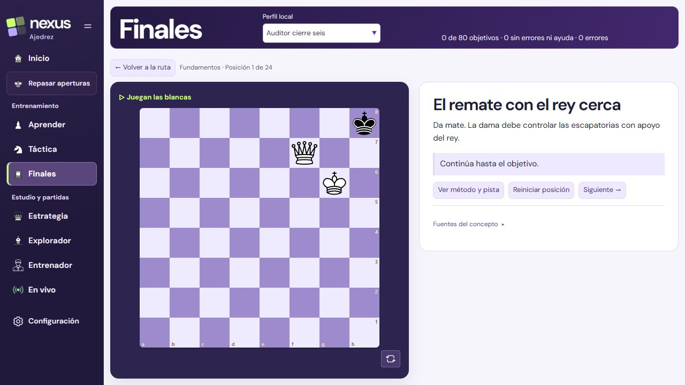

## 8. Strategic study / Estudio estratégico

Themed positions, personal continuations, study sessions and similar-position search. / Posiciones temáticas, continuaciones propias, sesiones y búsqueda de posiciones similares.

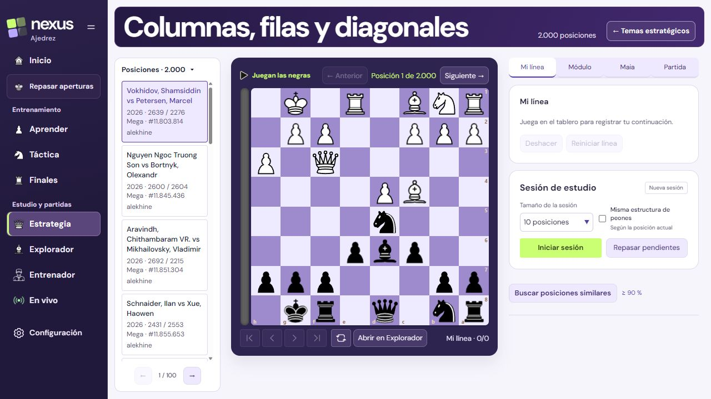

## 9. Coach workspace / Entrenador

Board context, coaching questions and game review. This capture honestly shows the state requiring provider configuration for new AI explanations. / Contexto del tablero, preguntas y revisión de partidas. La captura muestra el estado que requiere configurar un proveedor para explicaciones nuevas con IA.

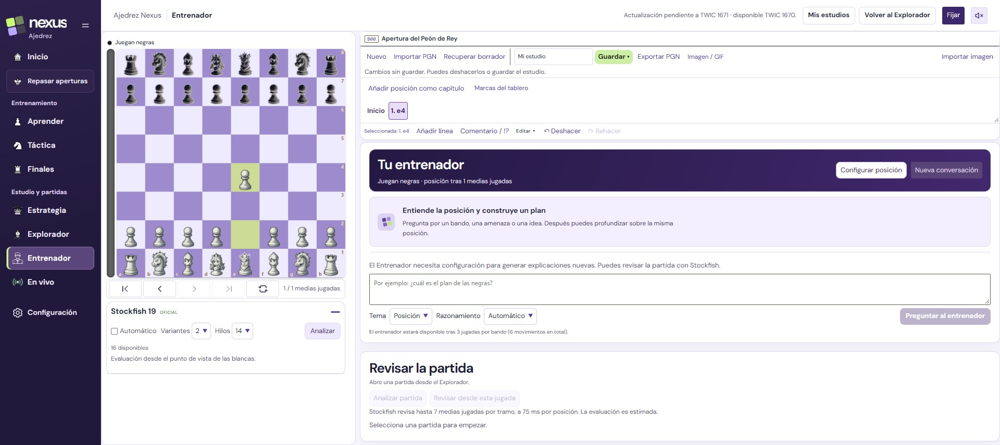

## 10. Personalization / Configuración

Board themes, piece styles, text size, contrast, sounds and header preferences. / Temas del tablero, piezas, tamaño de texto, contraste, sonidos y preferencias de cabecera.

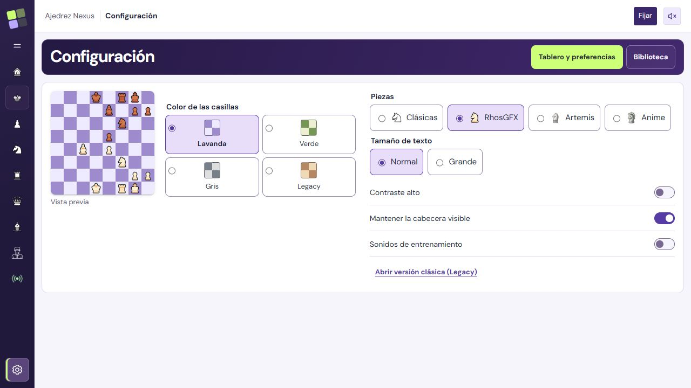

## 11. Lesson completion / Lección completada

Saved progress, a completion summary and the next learning step. / Avance guardado, resumen del logro y siguiente paso de aprendizaje.

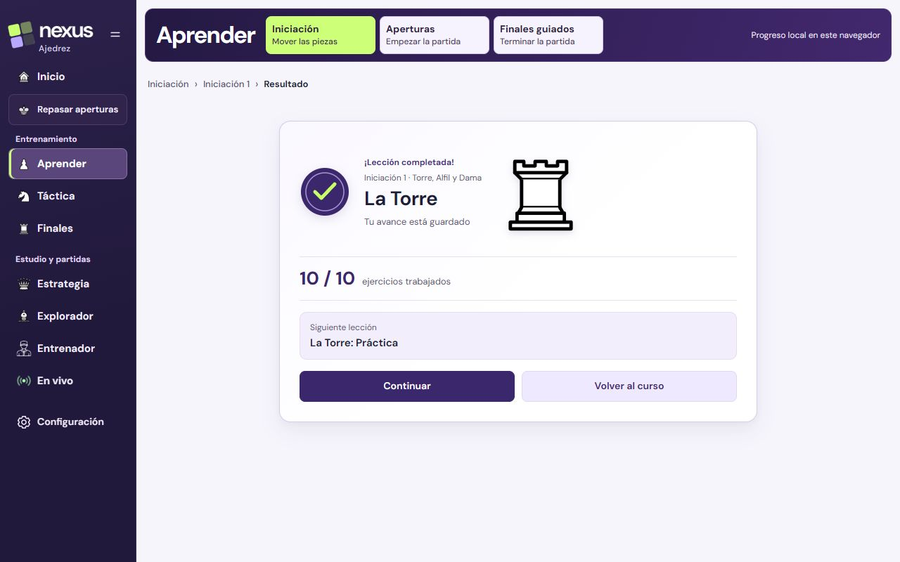

## 12. Exported study document / Documento de estudio exportado

A rendered PDF page from synthetic test content, including Unicode text, comments, variations and diagrams. It is an example output, not a personal preparation. / Página PDF renderizada de contenido sintético de prueba, con texto Unicode, comentarios, variantes y diagramas; no es una preparación personal.

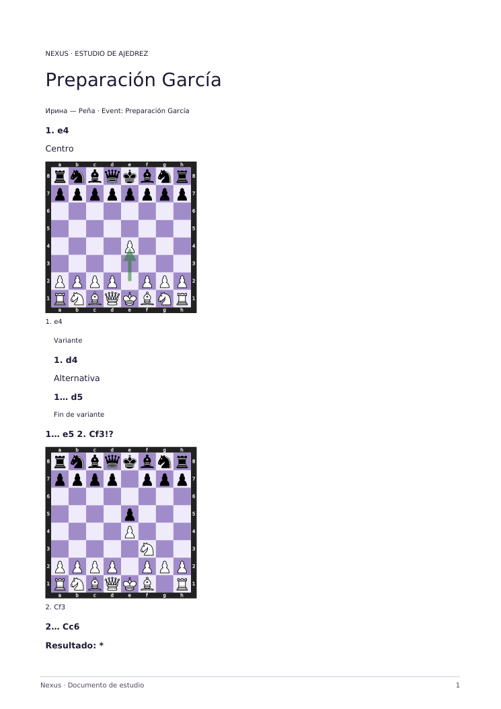
